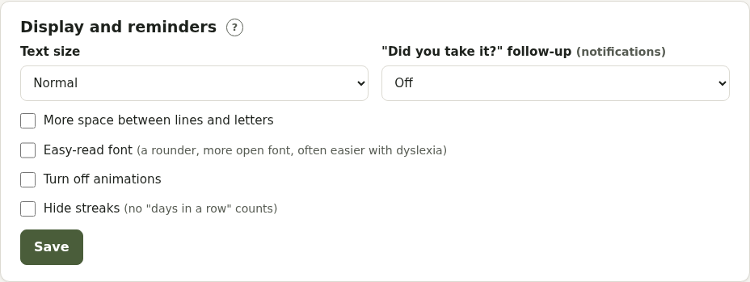

# Display and accessibility

**Account → Display and reminders**:

- **Text size**: normal, larger or largest
- **More space** between lines and letters
- **Easy-read font**: a rounder, more open font, often easier with dyslexia
- **Turn off animations** (Pillbox also follows your device's "reduce motion" setting)
- **Hide streaks**: no "days in a row" counts
- **"Did you take it?" follow-up**: a gentle notification 15, 30 or 60 minutes after a dose reminder if it isn't logged yet

## Built in for everyone

- **No blame**: doses not logged say "Not logged"; skipping is just a record
- **Log it later**: **At…** logs a dose with the time you actually took it
- **Now / Next** and a **timeline** of the day on Today
- A visual **timer**
- **Step by step**: running-low notices show order, collect, log stock
- **One-tap logging** and **Take all** for each part of the day
- Colour is never the only way something is shown: there's always a word or symbol too
- **High contrast** theme in Appearance
