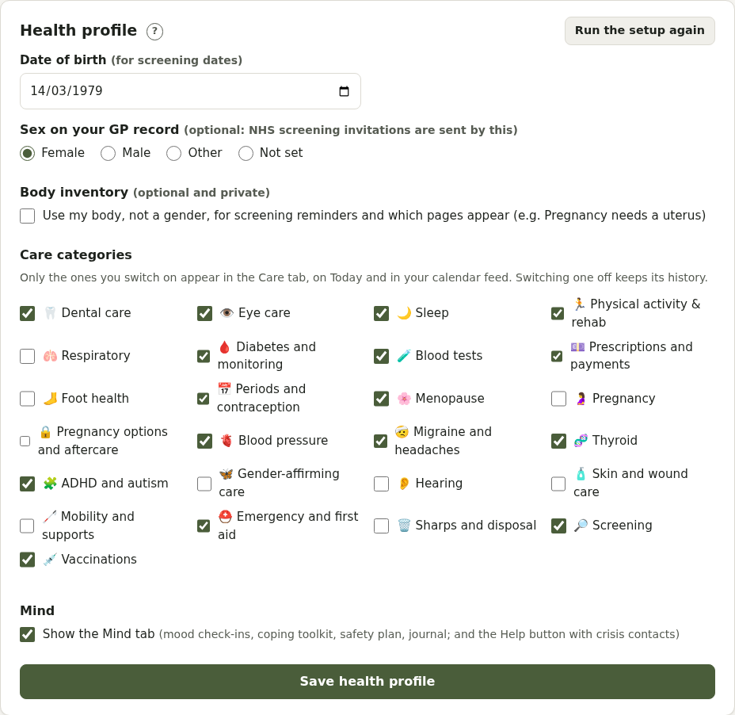

# Your account and health profile

Open **Account settings** from your name in the top bar.

## Profile

Your name, email, username, time zone, **pronouns** (shown on reports) and, optionally, your **gender identity** in your own words.

## Health profile

- **Date of birth**: for screening and age-based guidance
- **Sex on your GP record** (optional): NHS screening invitations are sent by this
- **Body inventory**: see below
- **Care categories** to switch on, and whether to show **Mind**

### Body inventory

Optional and private. For each of cervix, uterus, ovaries, breasts or chest tissue, prostate and testes: have, removed (with the date of surgery), or don't have. Tick **Use my body, not a gender** to let it decide:

- **Screening**: cervical (a cervix), breast (breast or chest tissue), AAA (a prostate or testes, now or before surgery), bowel (everyone 50 to 74)
- **Which pages appear**: Pregnancy and Pregnancy options need a uterus; premenstrual tracking needs ovaries

Change it any time.

## Notifications and email

- **Notifications on this device**: dose reminders, Care reminders and "coming up", appointments, and the Mind check-in. **Hide details on the lock screen** makes them all say "You have a reminder".
- **Email**: a daily summary at a time you choose, and appointment reminders (if your Pillbox sends email). Nothing from Mind is ever emailed.

## Display, privacy and appearance

See [Display and accessibility](accessibility.md) and [Privacy and security](privacy.md). **Appearance** has 8 colour themes, including high contrast, each in light, dark or automatic mode.

## Sign-in

Change your password, link a Microsoft or other sign-in, and **sign out everywhere else**.

## Your data

**Download all my data**, **import** a download into this account (for example when moving Pillbox), or **delete your account**.
