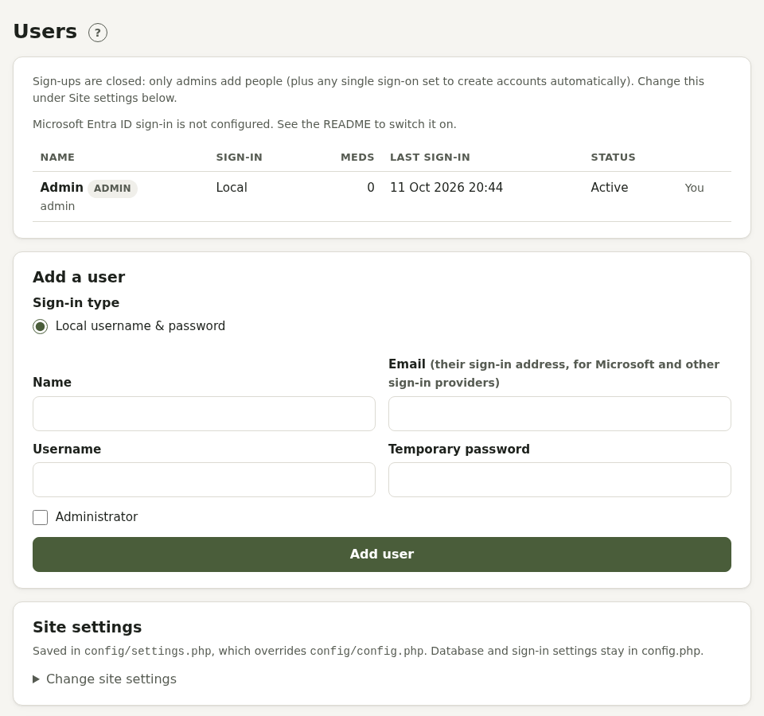

# Administration

For people who run a Pillbox. Installation is in the main [README](../README.md); this covers running it.

## Users

**Admin** (the shield icon) lists everyone: sign-in methods, medicines, last sign-in and status. **Manage** disables or enables an account, makes or removes an admin, unlinks a sign-in, resets a password, or deletes a user and all their data. **Add a user** creates a local account, or pre-registers someone for Microsoft or another single sign-on by email.



## Sign-ups

**Site settings → Sign-ups**:

- **Let people create their own accounts** (with a password or single sign-on)
- **An admin approves each new account**: waiting accounts can't sign in. They're listed under **Waiting for approval** with **Approve** and **Decline**, and admins see a notice on Today.
- **Email admins about each new sign-up**

People agree to the terms and privacy policy when they sign up. Single sign-on providers set to `auto_provision` create accounts without approval.

## Site settings

**Fill in from a policy document** (Private health care) reads uploads on this server with PHP's zlib (PDFs) and zip (Word) extensions, and needs uploads allowed up to the size of people's documents (`upload_max_filesize` and `post_max_size` in PHP; policy PDFs are usually under 2 MB). Nothing is stored.

**Forgotten your password?** on the sign-in page needs email to be set up (Site settings → Email). Without it, people are told to ask you, and you can reset a password from **Admin → Manage**.

**Site address**: set it in Site settings. Until it is, Pillbox uses the address an administrator last visited it at for links in emails and calendar feeds (never just the address a request claims, which anyone can fake), and won't send password reset emails until it knows one.

How long **Remember this device** keeps a device signed in is `remember_days` under `'app'` in `config/config.php` (90 days by default; 0 turns the option off).

**Active sessions** (each person's Account page) shows the IP address of each signed-in device. To show an approximate city and country too, set `'geoip_lookup' => true` under `'app'`: that sends each address to ipapi.co at sign-in, so it's off by default, and the privacy policy mentions it when it's on.

Behind a reverse proxy or load balancer, set `'trust_proxy' => true` under `'app'` so sign-in limits and session addresses use each visitor's own address. Only do this behind a proxy you control.

Site settings are saved to `config/settings.php` (which overrides `config/config.php`): site name and address, default time zone, update checks, weather for the headache diary (Open-Meteo), tidy addresses, email (PHP mail or SMTP), the scheduled tasks token, sign-ups, terms and privacy, connected services, and demo mode. If the `config/` folder isn't writable, Pillbox shows what to paste into `config.php` instead.

## Terms and privacy

The **Terms** and **Privacy** pages are generated from what Pillbox does. Fill in **Run by** (the data controller) and a **contact**, and the governing law if not England and Wales. Under **Use your own wording** you can replace either text. It's a starting point, not legal advice.

## Connected services

To let people connect WHOOP, Fitbit, Withings or Oura, register a free app with each, using the return address shown in Site settings, and enter the client ID and secret. Nightscout needs no setup; addresses on private networks are blocked unless you set `'nightscout' => ['allow_private' => true]`.

## Scheduled tasks

Reminders, notifications, email, connected app syncs, the check for a new version on GitHub and tidying up run on a schedule. Run every 5 minutes:

```
*/5 * * * * php /path/to/pillbox/bin/cron.php
```

Or set a token and have a web cron service call `cron.php?token=…`. The Admin page shows when they last ran, and **What they did**.

Notifications only go to the browsers' own push services (Google, Mozilla, Apple, Microsoft). To allow another, such as a self-hosted UnifiedPush server, add `'push' => ['allowed_hosts' => ['push.example.com']]` to `config/config.php`.

## Updates and backups

Admins see **Update available** in the footer when a new GitHub release is out (or **Development version** if this copy is ahead of the latest release). **Admin → Version** has **Check now**, the **Changelog** with every release's notes, and the **Licenses** of Pillbox and the code it includes. **Install version X now** backs up the current files, then updates them; **Restore** puts a backup back. `config/` and `storage/` are never touched, and the database updates itself on the next page load. Back up your database and `storage/` (especially `storage/app.key`, which encrypts private pages: without it they can't be read).
