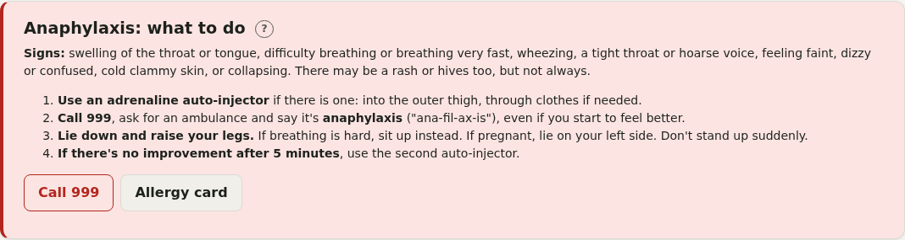
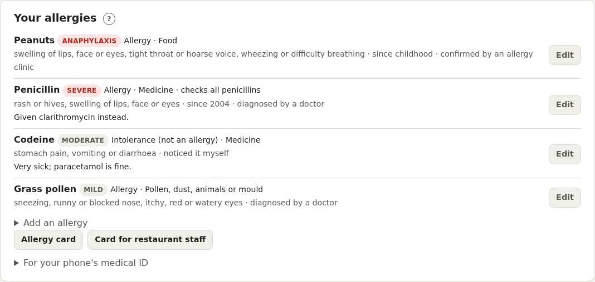
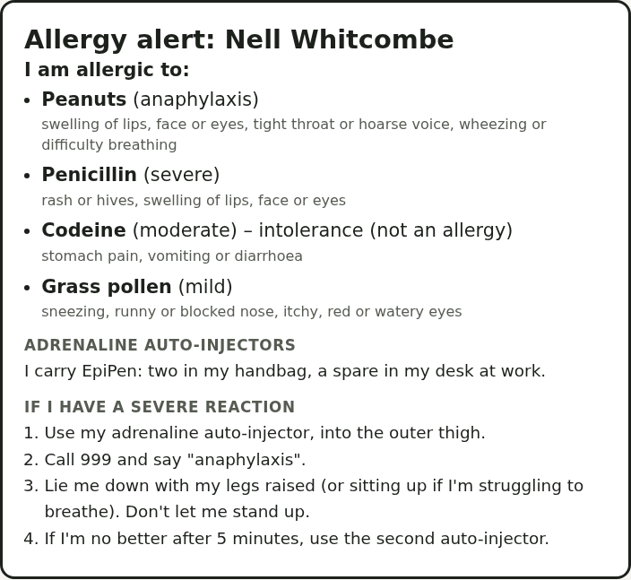

# Allergies

Switch on **Allergies** in your health profile. It's for allergies, intolerances and side effects to medicines, food, insect stings, latex, pollen, animals or anything else, and what to do in an emergency.

## Anaphylaxis

Anaphylaxis is a severe allergic reaction. The signs include swelling of the throat or tongue, difficulty breathing, wheezing, a tight throat or hoarse voice, feeling faint, dizzy or confused, clammy skin, or collapsing. What to do:

1. Use an adrenaline auto-injector if there is one, into the outer thigh.
2. Call 999 and say "anaphylaxis", even if you start to feel better.
3. Lie down and raise your legs (sit up if breathing is hard; lie on your left side if pregnant). Don't stand up suddenly.
4. If there's no improvement after 5 minutes, use the second auto-injector.

If you've recorded anaphylaxis or adrenaline pens, these steps are at the top of the page with a **Call 999** button. Otherwise they're one tap away.

## Your allergies

**Add an allergy**: what it's to (start typing for suggestions, including the 14 food allergens), the type, whether it's an **allergy**, an **intolerance** or a **side effect**, what happened, how severe, who confirmed it, and since when.

If you have none, tick **I have no known allergies**. Doctors and pharmacists need to know that as much as a list.

If an allergy no longer applies (for example after testing at an allergy clinic), mark it **No longer current** with the reason, rather than deleting it.

### Checking your medicines

For a medicine allergy, Pillbox checks your Meds by name. Tick **also warn about others in the same group** to check the whole group: penicillins, cephalosporins, anti-inflammatory painkillers (NSAIDs), opioids, sulfonamides, macrolides, tetracyclines or quinolones. A warning appears on the Meds page, on the Allergies page, and when you save a medicine that matches.

Pillbox can't know every brand or ingredient, so always check with a pharmacist too.

Your allergies are listed at the top of the Meds page and of the doctor's [report](reports.md).

## Adrenaline auto-injectors

Tick **I've been prescribed adrenaline auto-injectors**, and note which brand and where you keep them. Pillbox can track both pens' expiry dates and remind you to practise with a trainer pen. Carry two at all times.

## Allergy card

**Allergy card** shows your allergies, adrenaline pens and what to do in a severe reaction, in large text, to show someone or print. With food allergies there's also a **Card for restaurant staff**.

**For your phone's medical ID** gives a line to copy into the emergency information on your phone's lock screen.

## Food allergies

Tips for eating out and food labels, including Natasha's Law, and a reminder that some medicines contain food ingredients such as peanut (arachis) oil, soya or lactose.

## Pollen

If you've added a pollen allergy (grass, tree or weed pollen, or "hay fever"), add your town to see the pollen count for the next few days. It uses the same town as [migraine weather](migraine.md#weather), from Open-Meteo, and only the town's location (to about 10 km) is sent. Counts are only available in Europe. There are hay fever tips too.

## Checks and routines

Checks: adrenaline pen expiry, trainer pen practice, antihistamines in date, allergy clinic review, and keeping your allergy action plan up to date. A **Hay fever treatment** routine can remind you every day through your season.
