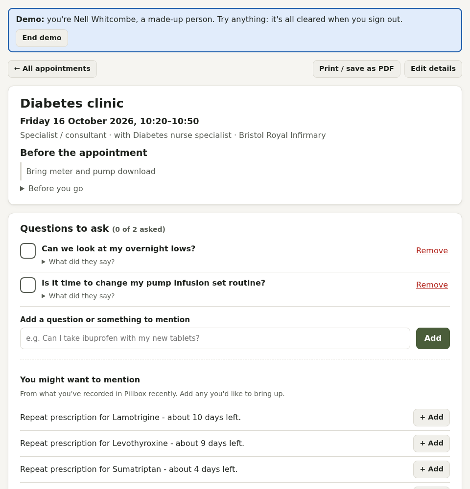

# Appointments

The calendar icon in the top bar opens **Appointments**. Add the date, time, type (GP, specialist, hospital, dentist, blood test, scan, antenatal, gender identity clinic and more), who it's with, where, notes and a reminder. The next two weeks also show on Today.

Tick **Private** for an appointment paid through private health care or by you, and choose which plan, the insurer's pre-authorisation number and the cost. Private appointments are marked in the list, the details (with your membership number) print on the appointment sheet, and afterwards you can record what you claimed back. See [Private health care](private-health.md).

## Preparing

Tap an appointment to open it:

- **Before you go**: a checklist (directions with a map link, your medicines list, questions, letters, someone to come with you, your communication passport, and stopping biotin before thyroid blood tests)
- **Questions to ask**, ticked off on the day with space for the answers
- **Suggested topics** from what you've recorded since last time
- **After the appointment**: what was decided, and actions agreed

**Print / save as PDF** gives a one-page sheet. If you've filled in a [communication passport](adhd-autism.md#communication-passport), it's printed on it too.

## Your calendar

**Add to your calendar** makes a private link that Apple, Google, Outlook or Proton calendars can subscribe to, so appointments (and Care reminders) appear there automatically. Anyone with the link can see your appointments, so **Make a new link** if it's ever shared by mistake.

### Proton Calendar

1. In Pillbox, press **Copy** next to your calendar link.
2. Go to [calendar.proton.me](https://calendar.proton.me) on the web (subscriptions can't be added in Proton's apps).
3. Press **+** next to **My calendars** (or go to **Settings → Calendars → Other calendars**) and choose **Add calendar from URL**.
4. Paste the link, choose a name and colour, and press **Add calendar**.

It then appears in Proton's phone and desktop apps too. Proton checks for changes every 4 to 16 hours, so new appointments can take a while to show up. A subscribed calendar counts towards the number of calendars your Proton plan allows.

Proton, Google and the others fetch the link from the internet, so your Pillbox needs to be reachable from outside your home network.
