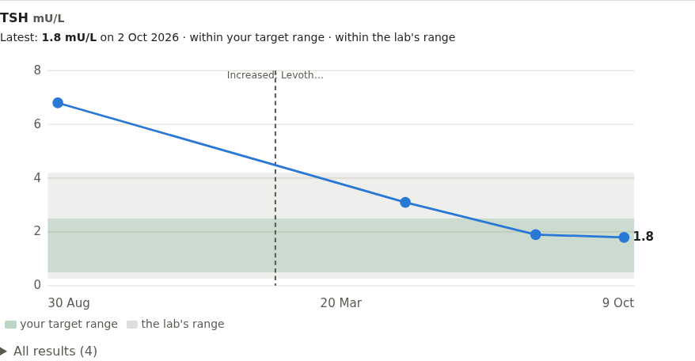

# Blood tests

Switch on **Blood tests** in your health profile. It has two parts.

## Reminders for tests

Ready-made reminders for routine and specific tests (full blood count, kidney and liver function, HbA1c, cholesterol, thyroid, vitamins and iron, clotting and INR, medicine levels such as lithium, PSA, and the NHS Health Check), each with notes on what it's for and how to prepare. Add the ones you need, mark them done, and note results. Link a test to the medicine it's monitoring if you like.

## Results and trends

**Add a result** records a number in UK units (for example testosterone in nmol/L, oestradiol in pmol/L, HbA1c in mmol/mol, TSH in mU/L):

- **Blood taken on / at**: when the blood was drawn
- **Timing**: just before a dose (the "trough", how injections are usually checked), soon after, between doses, or not relevant
- **Related medicine**: Pillbox works out how long it had been since your last logged dose
- **Lab's range**: copy it from the report if you like

Each test gets a chart. Shaded bands show the lab's range and **your target range**: set one under **All results** (from your clinic, for example). Lab ranges follow the sex on your record, which often doesn't fit on hormones, so you can keep both. Pillbox only says where a result sits ("above your target range"); your clinic interprets it.

Charts for TSH and free T4 show thyroid dose changes as dashed lines.
