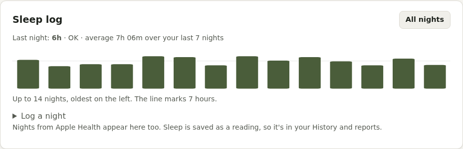
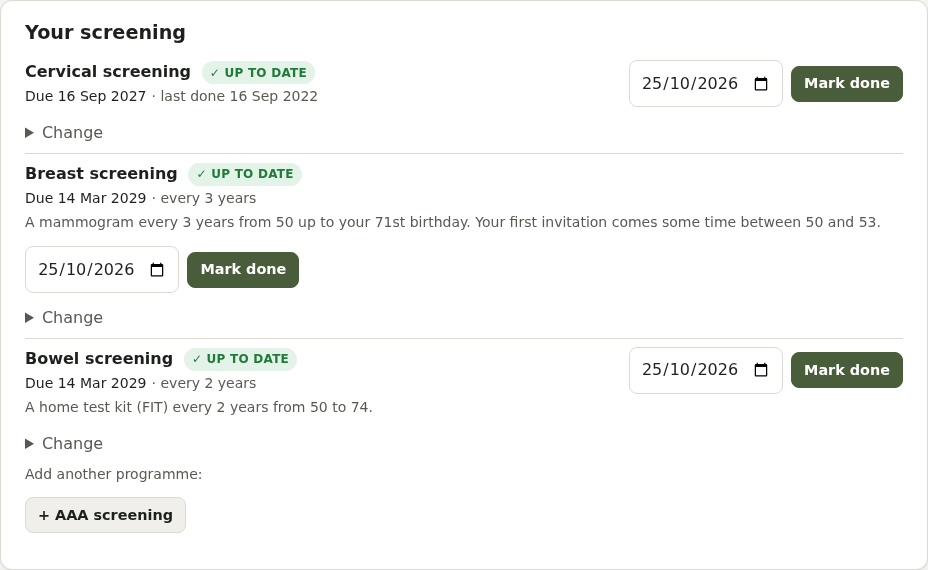
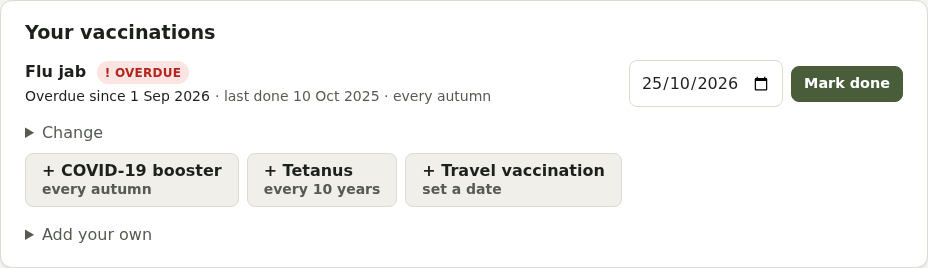
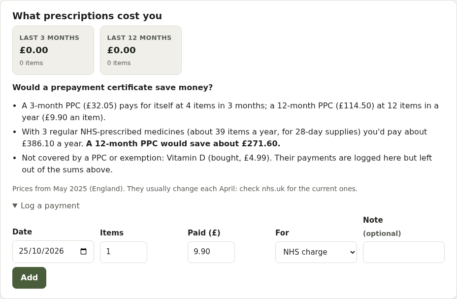

# Everyday Care categories

What's in each of the everyday Care categories. Every category works the same way (see [Care](care.md)): **routines** are ticked off on Today, and **checks** come up when they're due. Add the ready-made ones with one tap, or your own. Categories with their own pages are listed in the [documentation contents](README.md#care-categories).

## Dental care

The NHS advises brushing twice a day for about 2 minutes with fluoride toothpaste, and cleaning between your teeth every day.

- **Routines**: brush teeth, clean between teeth, mouthwash, clean tongue, clean a retainer, clean dentures, replace your toothbrush or brush head, clean a night guard
- **Checks**: dental check-up, night guard check (at your dental visit), hygienist

## Eye care

- **Routines**: screen breaks, cleaning eyelids, taking contact lenses out, cleaning the lens case, replacing lenses, removing eye make-up
- **Checks**: eye drops once opened (many must be thrown away 28 days after opening: mark when you open a new one), eye test, diabetic eye screening

## Sleep

Most adults need 7 to 9 hours a night; going to bed and getting up at about the same time helps most.

- **Sleep log**: when you went to bed and got up, and how well you slept. It's saved as a Sleep reading, alongside any from Apple Health or a connected tracker.
- **Routines**: start winding down, bedtime, cleaning a CPAP mask, emptying the CPAP humidifier, washing CPAP tubing

- **Checks**: CPAP or sleep clinic review

## Physical activity & rehab

The NHS advises at least 150 minutes of moderate activity a week, and strengthening on at least 2 days. Physio exercises work best little and often.

- **Routines**: physio exercises, stretching, a mobility routine, strength exercises, a walk, balance exercises. Add an amount, like "10 reps" or "20 minutes".
- **Checks**: physio review

## Respiratory

- **Routines**: peak flow, cleaning a nebuliser, washing a spacer
- **Checks**: asthma or COPD review, and replacing a spacer, peak flow meter, and CPAP and nebuliser parts (mask cushion, filter, tubing, frame and headgear, humidifier chamber, nebuliser chamber and mask, compressor filter), each on its own schedule

## Foot health

Checking your feet every day matters if you have diabetes, poor circulation or numbness.

- **Routines**: check your feet, moisturise, wash and dry, nail care
- **Checks**: diabetes foot check, podiatry appointment

## Hearing

- **Routines**: cleaning hearing aids, changing batteries or charging them, ear protection
- **Checks**: hearing test, hearing aid service, changing domes and wax filters, audiology review

## Skin and wound care

Check your skin and moles once a month, and see a GP about any changes.

- **Routines**: skin and mole check, sunscreen, moisturising
- **Checks**: a skin check with a GP or dermatologist, dressings and emollients to keep in stock, sunscreen once opened

## Mobility and supports

Braces, supports, compression stockings, walking aids and insoles wear out, often before you notice.

- **Routines**: putting on and washing compression stockings
- **Checks**: replacing compression stockings, braces or supports, walking aid ferrules and tips, orthotics or insoles, and a wheelchair or scooter service

## Emergency and first aid

- **Checks**: adrenaline auto-injector expiry dates (and a second one), the contents of a first aid kit and an emergency medicines bag (tick each item as you check it), testing smoke and carbon monoxide alarms, and a fire extinguisher check

## Sharps and disposal

- **Checks**: how full your sharps bin is, booking a sharps collection, and taking unused medicines back to a pharmacy
- **Medicines to take back**: stopped medicines you still have some of, and anything past its expiry date, are listed here.

## Screening

NHS screening (cervical, breast, bowel and AAA), with when each is next due, worked out from your date of birth and your [body inventory](account.md#body-inventory) or the sex on your GP record. If an invitation might not arrive automatically because of your GP record, the page says so. Mark each one done when you've been screened.

- **Routines**: a monthly breast self-check reminder (Touch, Look, Check), based on [CoppaFeel](https://coppafeel.org)'s approach, and a monthly testicular self-check reminder, based on [Movember](https://movember.com)'s "It's in the Bag" guide. The breast one is separate from NHS breast screening, which starts at 50.

## Vaccinations

- **Checks**: flu jab (every autumn), COVID-19 booster, tetanus, and travel vaccinations, with when each is next due

## Prescriptions and payments

Prescriptions are free in Scotland, Wales and Northern Ireland; in England, free if you're 60 or over, under 16, 16 to 18 in full-time education, or have an exemption certificate.

- **Checks**: prepayment certificates (PPC and HRT PPC) and exemption certificates (MedEx, MatEx, HC2), with a reminder before each one ends
- **What prescriptions cost you**: a payment log, totals for the last 3 and 12 months, and whether a PPC would save you money. Private and bought medicines are kept out of the PPC sums.

