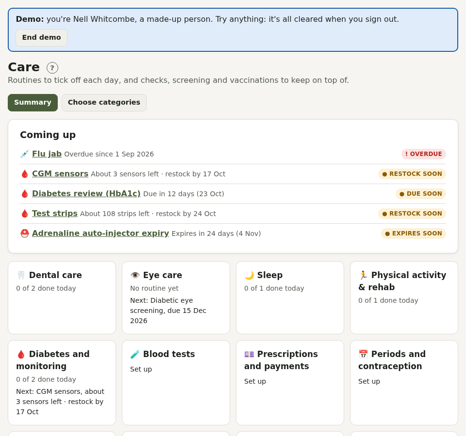
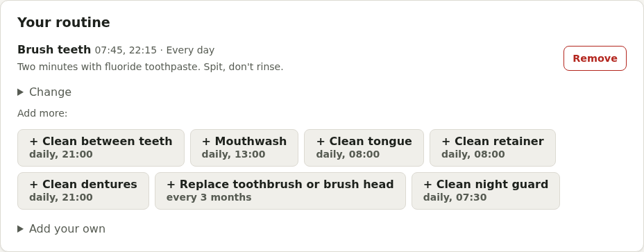
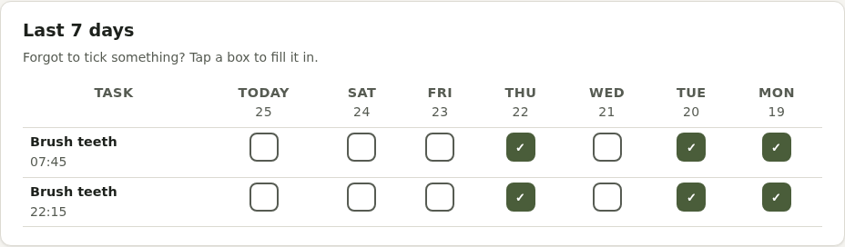
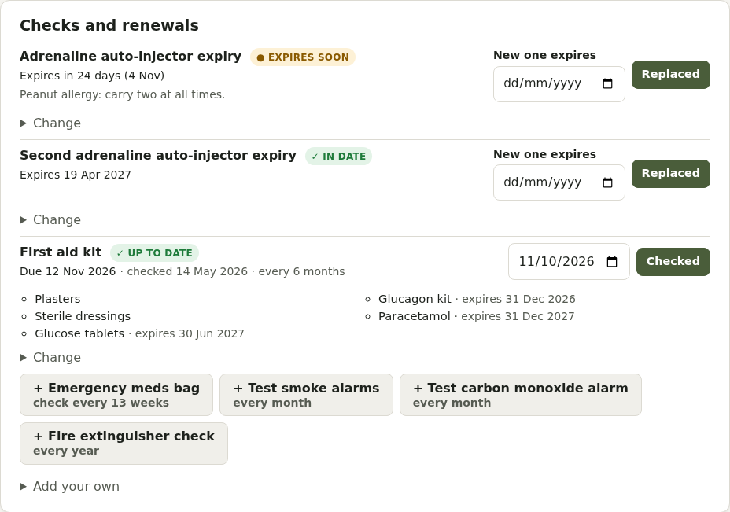
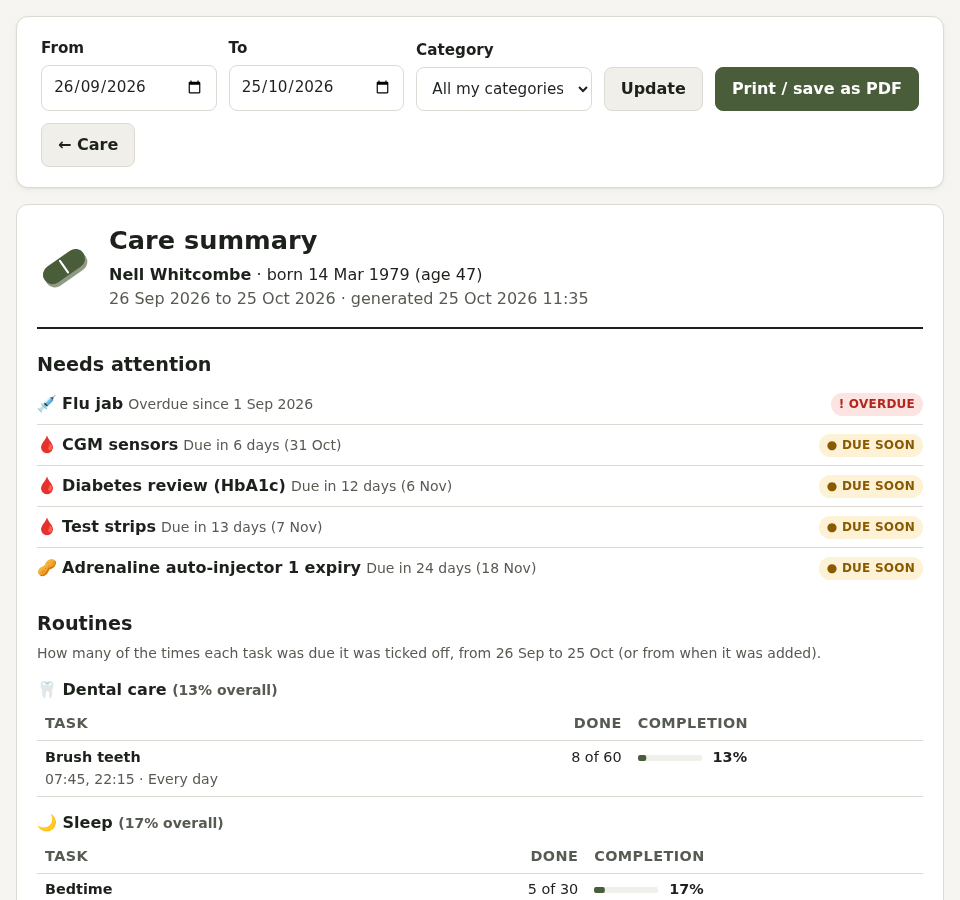

# Care

The **Care** tab is for looking after yourself beyond medicines. Switch categories on in **Account → Health profile**: only the ones you choose appear.

Categories include dental, eyes, sleep, activity and rehab, respiratory, allergies, private health care, diabetes, blood pressure, thyroid, migraine, blood tests, prescriptions and payments, feet, periods and contraception, menopause, pregnancy, hearing, skin, mobility, emergency and first aid, sharps and disposal, screening, vaccinations, ADHD and autism, and gender-affirming care. Some appear only if they fit your [body inventory](account.md#body-inventory).

## Routines

Daily or regular tasks (brush teeth, physio exercises, change a CPAP filter) ticked off on Today. Use a one-tap preset or add your own: times, days or every few days, and an amount (like "10 reps").

 A 7-day grid lets you tick off days you missed. Streaks can be hidden in [Display and accessibility](accessibility.md).

## Checks and renewals

Things due now and then, each tracked the way that suits it:

- **Due every so often**: eye tests, a medicine review, a foot check
- **Expiry date**: an EpiPen, a certificate, or "use within 28 days of opening" for eye drops or an insulin pen
- **Stock to keep up**: test strips, needles, pens
- **Fill level**: a sharps bin
- **Kit contents**: a first aid or hypo kit

**Done** records it and works out the next date. Anything due soon shows under **Coming up** on Today, and as a calendar event.

## Screening and vaccinations

NHS screening (cervical, breast, bowel, AAA) is worked out from your date of birth and your body inventory (or the sex on your GP record). If an invitation might not arrive automatically because of your GP record, the Screening page says so, so you can ask your practice.

## Prescriptions and payments

Prepayment and exemption certificates (PPC, HRT PPC, MedEx, MatEx, HC2) with renewal reminders, a cost log, and a calculator showing whether a PPC would save you money. Private and bought medicines are kept out of the PPC sums.

## Care summary

**Care summary** prints everything in Care over a period, for a GP, physio or nurse.

What's in each everyday category is in [Everyday Care categories](care-categories.md). Several categories have their own pages and summaries: see the [list of Care categories](README.md#care-categories).
