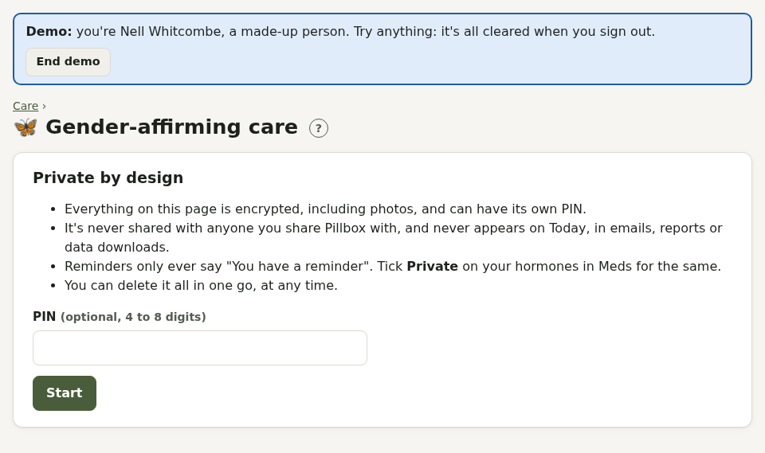

# Gender-affirming care

A private page, like Pregnancy options: everything is encrypted (including photos), it can have its own **PIN**, it's never shared, and **Delete everything** removes it all.

- **Your care**: gender identity clinic and referral date (Pillbox shows how long you've waited), first appointment, who prescribes (GIC, GP under shared care, or private), and your shared care agreement with a reminder a month before it needs renewing
- **Hormones**: your hormones with dose and stock, and one-tap set-ups (testosterone gel or injections every 2 to 3 or 10 to 14 weeks, oestradiol patches, gel, spray, tablets or injections, progesterone, blockers, anti-androgens), marked private. Set your own dose, including low or micro doses.
- **Fertility**: a note and an optional reminder to talk about fertility preservation
- **Changes journal**: fields you choose (voice, dysphoria, mood… or your own)
- **Progress photos**: encrypted, kept only in Pillbox, never in backups or downloads

## Related

- Hormone levels go in [Blood tests](blood-tests.md#results-and-trends), with your clinic's target range alongside the lab's.
- Injections suggest the next **site** in your rotation.
- Your [body inventory](account.md#body-inventory) decides your screening reminders, and the Screening page points out invitations that might not arrive because of your GP record.
- [Privacy](privacy.md): private medicines, hiding the screen when switching apps, and a disguised home-screen icon.
- Support: Mermaids (young people and families) and Switchboard (LGBTQIA+ helpline), and your safety plan in Help.
