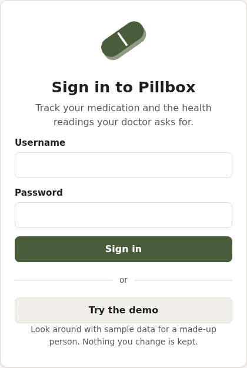

# Getting started

## Signing in

Sign in with your username and password, or with a single sign-on button (such as Microsoft or Google) if your Pillbox has one. If sign-ups are open, **Create an account** on the sign-in page lets you make your own account. Some Pillboxes ask an administrator to approve new accounts first: you'll be told, and emailed when you're approved if you gave an email address.

**Forgotten your password?** on the sign-in page emails a link to choose a new one, to the email address on your account. It works once, for an hour, and signs you out on all your devices. If your account has no email address, or your Pillbox can't send email, ask whoever runs it to reset your password. If you sign in with Microsoft or another sign-in button, your password is managed there.

**Remember this device** keeps a phone or computer you use often signed in, for 90 days after you last used it (each use starts the 90 days again). It works with single sign-on too. Don't tick it on a shared or public computer. Mind and the private pages still ask for their PIN.

Want to look around first? If the demo is switched on, **Try the demo** opens a sample account for a made-up person. Nothing you change there is kept.

## The first-time setup

The first time you sign in, a short setup walks you through:

1. **About you**: your name, time zone, and (optionally) date of birth and the sex on your GP record, for screening reminders.
2. **What to use**: the Care categories and measurements you want. Everything else stays out of the way.
3. **Private health care**: if you have private medical insurance, a health cash plan or a dental plan, add it (see [Private health care](private-health.md)).
4. **Reminders**: email summaries and notifications on this device.

You can skip any step, and change everything later in **Account settings** (or run the setup again from there).

## Finding your way around

The tabs along the bottom (or top, on a bigger screen) are:

- **Today**: what to take today, and anything coming up
- **Meds**: your medicines
- **Care**: routines, checks and the Care categories you've switched on
- **Mind**: mood, coping tools and your safety plan (if switched on)
- **Readings**: measurements like blood pressure and weight
- **History**: what you took, and reports

The top bar has **Help** (crisis contacts, always one tap away), **Appointments**, **Sharing**, and your **Account**.

Look for the **?** next to headings: it opens the part of this documentation about that screen.

## Installing it on your phone

Pillbox works like an app once it's on your home screen:

- **iPhone or iPad**: open Pillbox in Safari, tap Share, then **Add to Home Screen**.
- **Android**: open it in Chrome, tap the menu, then **Install app**.

It then opens full screen with its own icon, and can send you notifications (on iPhone, only once it's on the home screen). You can give it a disguised name and icon: see [Privacy and security](privacy.md).
