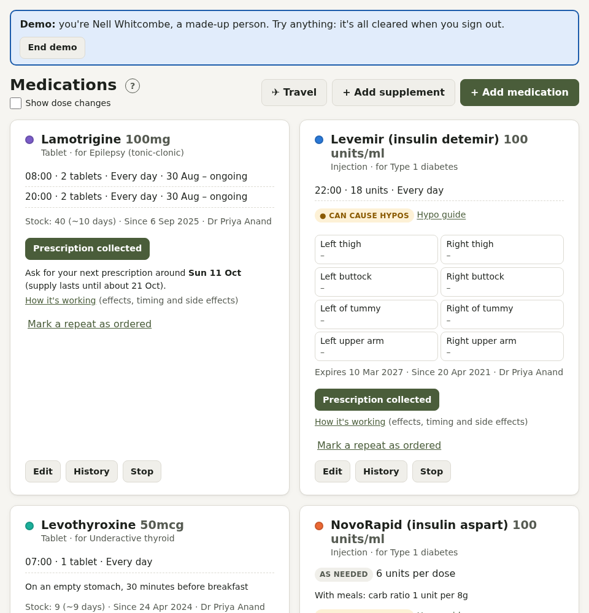
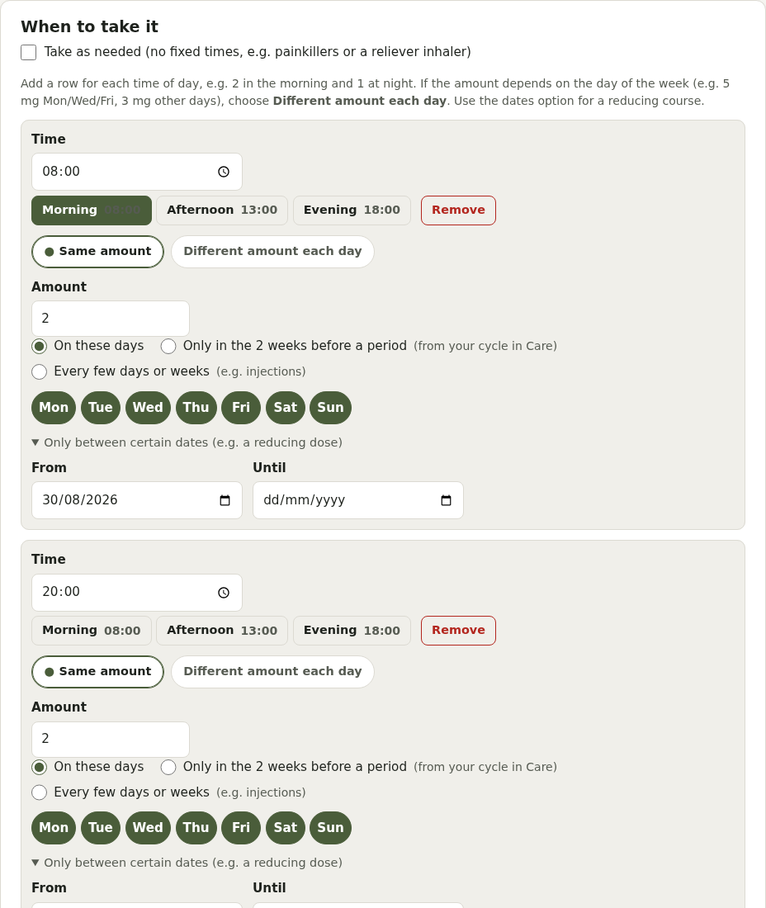
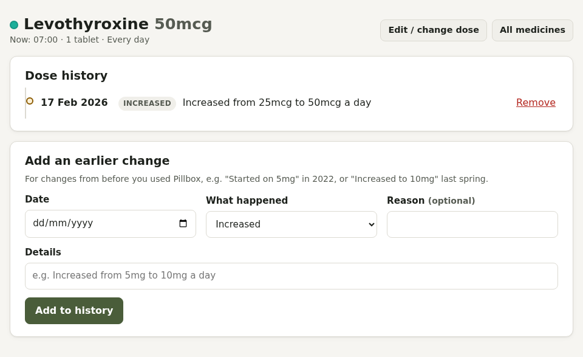
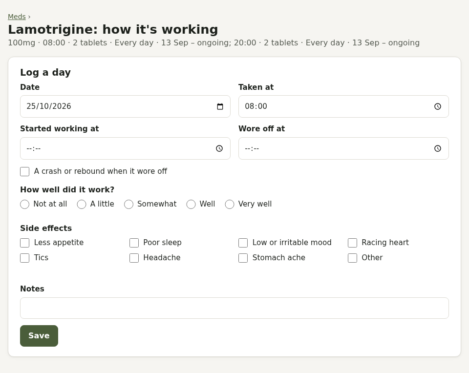
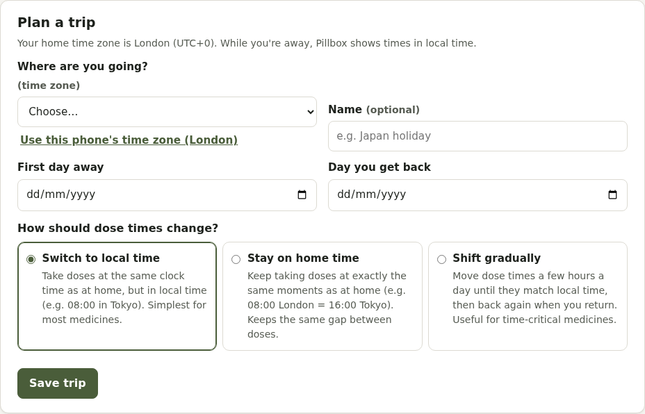

# Medicines

The **Meds** tab lists your current medicines, then **Supplements**, then stopped medicines.

## Adding a medicine

Press **+ Add medication** (or **+ Add supplement**). If your Pillbox has the NHS medicines dictionary switched on, start typing to find the exact product: it fills in the name, strength and form. Otherwise type them in.

- **Dose measured in**: tablets, capsules, ml, puffs, pumps, patches and so on
- **Brand or manufacturer**: optional; some people notice a difference when it changes
- **How you get it**: NHS prescription, private prescription, or bought without one (with a price)
- **Controlled drug**: for medicines like ADHD stimulants, whose prescriptions usually cover 30 days and must be collected within 28 days of being written
- **Private**: reminders and emails just say "Reminder", and it's hidden from anyone you share Pillbox with
- **Supplement**: listed separately
- **Mental health medicine**: shown in Mind too (if Mind is switched on)

### When to take it

Add a row for each time of day. The **Morning**, **Afternoon** and **Evening** buttons fill in a usual time. For each row choose:

- **Same amount** on chosen weekdays, or **Different amount each day**
- **Repeats**:
  - **On these days** (weekdays)
  - **Every few days or weeks** (for example an injection every 3 weeks), from the first or next dose
  - **Only in the 2 weeks before a period** (worked out from your cycle in Care)
  - **Some days of a repeating cycle**: for example sequential HRT, with progestogen on days 15 to 28 of every 28 days (set which day is day 1), the 1st to the 14th of each calendar month, or 14 days every 13 weeks. Reminders and stock only count those days, and the Meds page shows which day of the cycle it is.
- **Only between certain dates**: for a reducing dose

Or tick **Take as needed** (no fixed times), with a usual dose and a daily maximum.

**Minimum time between doses** (in hours, for any medicine): Pillbox won't log a dose sooner than this after the last one, for example 4 hours for paracetamol. It says when the next dose is allowed, on Today and the Meds page. If you did take it sooner, **I took it: log anyway** records it, so your history stays accurate. Only take a dose sooner if a doctor or pharmacist has told you to.

### How long

- **Ongoing**, with an optional end date
- **Short course** (for example 7 days of antibiotics): shows "Day 3 of 7" and moves to stopped medicines by itself when it's finished
- **One-off dose**

### One-tap set-ups

Some Care pages have buttons that open this form already filled in: HRT, gender-affirming hormones, thyroid and PMDD treatments, folic acid and vitamin D. Check it matches your prescription before saving.

## Changing a dose

Edit the medicine and change the amounts or times. Changes only apply from now on: past doses and your history keep the old dose. If today's doses are already logged, the change starts tomorrow. Each change is recorded in the medicine's history ("Increased from 10mg to 20mg a day"); tick **Show dose changes** on the Meds page to see the latest one under each medicine. Each medicine's **History** shows every change, and you can add earlier ones from before you used Pillbox.

## Stock and prescriptions

Enter **Stock on hand** to keep count: it goes down as you log doses.

- **Prescription collected** adds what you picked up (with an optional expiry date, brand, and price for private or bought medicines).
- **Mark a repeat as ordered** remembers you've asked for more.
- Pillbox shows when supply runs out and when to **ask for your next prescription**. For controlled drugs, enter the date the prescription was written to see the **collect by** date. You can get notifications for both.
- **Pharmacy, prescription and stock notes** (controlled drugs) keep track of shortages ("out of stock at the High St pharmacy").

## How it's working

**How it's working** on each medicine logs a day at a time: when you took it, when it started working, when it wore off, any crash, how well it worked, and side effects. It shows a timeline and a table comparing each dose (useful when a dose is being adjusted), and with cycle tracking, whether it works differently before a period.

## Warnings

Pillbox points out a few things that are worth asking about, such as:

- thyroid medicine taken within 4 hours of calcium, iron, antacids or minerals
- combined hormonal contraception with migraine with aura, or with raised blood pressure
- topiramate if you could become pregnant
- medicines that can cause hypos (low blood sugar)

These are prompts to talk to your GP or pharmacist, not instructions.

## Travel

**Meds → ✈ Travel** plans a trip across time zones: where you're going, when you leave and get back, and how dose times should change:

- **Switch to local time**: the same clock time where you are (08:00 in Tokyo). Simplest for most medicines.
- **Stay on home time**: the same moment as at home (08:00 London is 16:00 Tokyo), keeping the same gap between doses.
- **Shift gradually**: dose times move 1 to 4 hours a day until they match local time, then back again when you return. Useful for time-critical medicines.

While you're away, Pillbox shows times in local time, and each dose also shows its home time. If you take time-critical medicines (insulin, contraceptive pills, or medicines for epilepsy, Parkinson's or HIV), check with a doctor or pharmacist before you go.

## Stopping a medicine

**Stop** keeps all its history. **Restart** brings it back. **Delete** removes it and its history for good. Leftover stopped medicines appear in Care > Sharps and disposal, as a reminder to take them back to a pharmacy.
