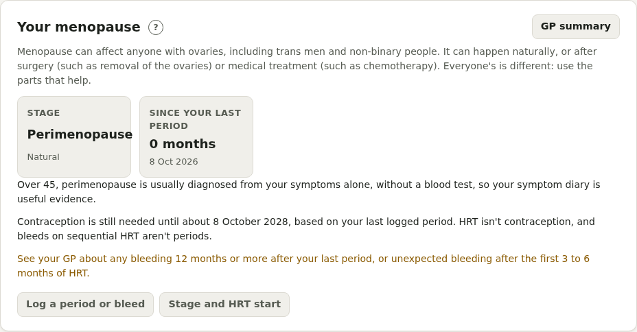
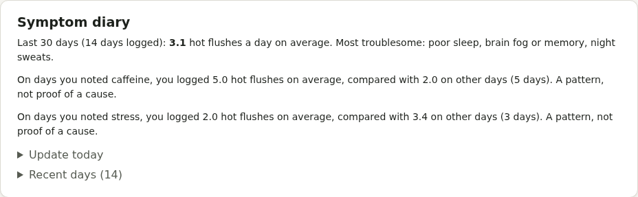

# Menopause

For anyone with ovaries going through perimenopause or menopause, naturally or after surgery or medical treatment.

- **Your menopause**: stage, cause, HRT start date, and **months since your last period** (12 months usually confirms menopause). **Log a period or bleed** adds to the same period log. Bleeding 12 months or more after your last period, or unexpected bleeding after 3 to 6 months of HRT, brings up advice to see your GP.
- Notes on **early or premature menopause**, and when **contraception** is still needed (2 years after your last period if under 50, 1 year if over, not after 55)
- **Symptom diary**: hot flush count and severity, 12 symptoms, and possible triggers. Pillbox shows averages and patterns ("more flushes on caffeine days").
- **Symptom score**: the Greene Climacteric Scale, every month or two, to see change over time
- **HRT and treatments**: your HRT with stock, and one-tap set-ups for patches, gel, spray, tablets, progestogen, vaginal oestrogen and testosterone. **Progestogen (part of each cycle)** is for sequential HRT: it repeats by itself, for example days 15 to 28 of every 28-day cycle or the first 14 days of each month, so there's nothing to re-enter each month. The HRT prepayment certificate is in Prescriptions and payments.
- **Bones and heart**: vitamin D, calcium and exercise, and screening
- **Work**: notes for workplace adjustments (not included in the GP summary)
- **Checks**: HRT review, blood pressure, bone density scan, Mirena replacement

**GP summary** prints your stage, periods, symptoms over 3 months, scores and treatment.
