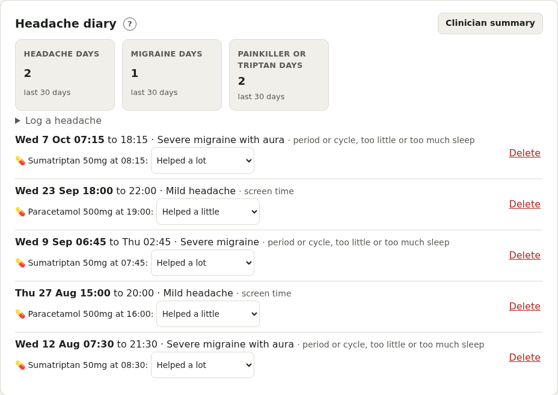
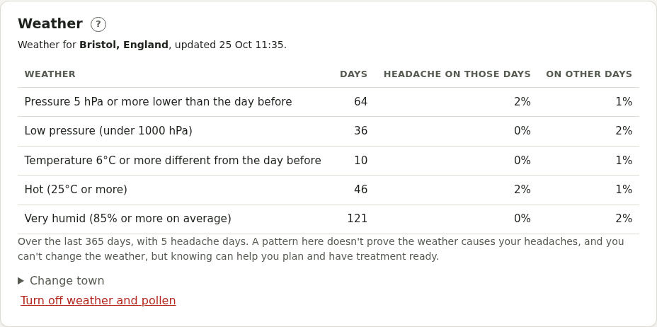
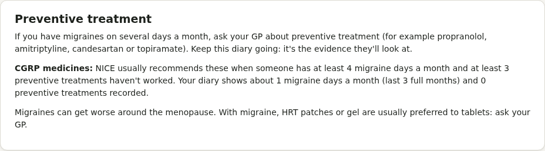

# Migraine and headaches

## Red flags

Call 999 or go to A&E for: a sudden, severe headache that peaks within a minute or so; a headache with fever and a stiff neck or rash; a headache after a head injury; or new weakness, numbness, slurred speech, confusion, a fit or loss of vision.

## Headache diary

**Log a headache**: when it started and ended (or **Still going**: press **It's gone** later), how bad, where, whether it's a migraine, aura, symptoms, possible triggers, and anything you took with how well it helped. A medicine from your Meds list can be logged as a dose at the same time, so stock stays right.

The tiles show **headache days**, **migraine days** and **painkiller or triptan days** in the last 30 days (including as-needed doses logged on Today), and a table shows month by month.

## Medication overuse

Painkillers or triptans on too many days can cause rebound headaches. Pillbox warns at:

- 15 or more days a month of simple painkillers (paracetamol, ibuprofen, aspirin)
- 10 or more days a month of triptans, codeine or other opioids, combination painkillers, or a mix
- and nudges you from 8 days a month to talk to your GP

## Patterns

The triggers you note most often, and **menstrual migraine**: how many migraine days fall from 2 days before to 3 days after a period starts.

## Weather

Under **Weather**, add your town and Pillbox fetches the weather there (from Open-Meteo, a free weather service), including the last year, and keeps it up to date. Only the town's location, to about 10 km, is sent: nothing about you or your headaches.

- Each diary entry shows the air pressure that day, how far it fell, and the temperature.
- Once there's a month of weather and 5 headache days, a table compares how often you had a headache on days with **a big fall in pressure** (the day's average 5 hPa or more below the day before's), **low pressure**, **a big temperature change**, **hot** or **very humid** weather, with other days. Where headaches look more likely, it says so.
- If pressure is forecast to fall sharply today or tomorrow, the Weather card says so. If falls have been linked to your headaches, Today shows a heads-up too.

A pattern doesn't prove the weather causes your headaches, but it can help you plan and have treatment ready. **Turn off weather** deletes the town and its weather. Admins can switch weather off for the whole site.

## Preventive treatment

Preventives (propranolol, amitriptyline, candesartan, topiramate, CGRP medicines and others) are recognised automatically, with migraine days before and after starting from 2 months in. Pillbox also shows the evidence NICE looks at for CGRP medicines: migraine days a month, and preventives tried.

Warnings appear for **topiramate** if you could become pregnant, and for **combined hormonal contraception** if you've had migraine with aura (a stroke risk).

**Clinician summary** prints 6 months of counts, features, triggers, how well treatments help, and preventives.
