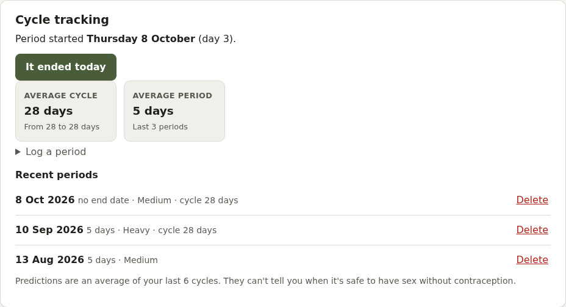
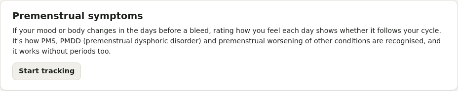

# Periods, contraception and premenstrual symptoms

**Periods and contraception** in Care is for anyone who has periods or bleeding, including occasional bleeding on testosterone. You can switch it off completely.

## Periods

**Log a period** with the start date (and end date, flow and notes). Pillbox shows your average cycle and period length and when the next period is expected. It doesn't predict fertile days: that isn't reliable enough for contraception.

## Contraception

Checks for pill reviews, implant, coil and injection renewals, and a link to add the pill or HRT as a medicine.

## Premenstrual symptoms (PMS, PMDD, PME)

Press **Start tracking** to rate how you feel each day. Doing it every day of the month for at least 2 cycles shows whether symptoms follow your cycle.

- **Quick check-in**: 7 questions, a few seconds a day, rated 1 (not at all) to 6 (extreme)
- **All the questions**: the full DRSP (Daily Record of Severity of Problems) that clinicians recognise
- **Today I…**: exercise, caffeine, alcohol, short sleep
- **No bleed?** If you're on testosterone, have had a hysterectomy but kept your ovaries, or have irregular cycles, **mark day 1** of a cycle yourself.

What you get:

- **Day of your cycle** and phase, and when harder days may start. Turn on a **heads-up** notification if you like.
- **By cycle day**: cycles stacked, coloured by severity, with the 2 weeks before a bleed shaded
- **Before and after each bleed**: the week before compared with days 4 to 10. A rise of 30% or more that settles after the bleed is the usual premenstrual pattern; symptoms all month that get worse before it suggest premenstrual worsening of something ongoing. Show your GP: it isn't a diagnosis.
- **Treatments**: one-tap set-ups (an SSRI taken only in the 2 weeks before a period, the combined pill taken continuously, GnRH with add-back HRT), compared before and after starting
- **GP summary** with each symptom's average before and after a bleed

If you rate hopelessness, feeling overwhelmed or out of control as severe, Pillbox gently shows your safety plan and Samaritans (116 123). It never blocks you.
