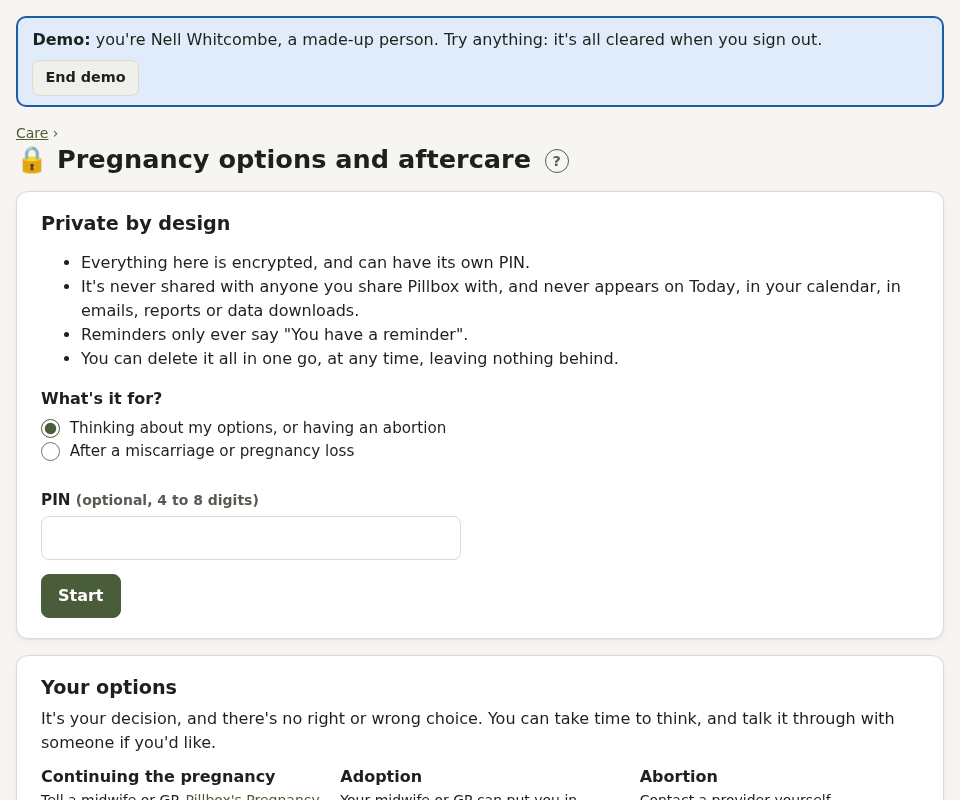

# Pregnancy options and aftercare

A private page for deciding what to do about a pregnancy, having an abortion, or aftercare after a miscarriage or pregnancy loss. It's in Care as **Pregnancy options and aftercare** (shown as "Private" on the Care tab).

## Private by design

- Everything is encrypted, and can have its own **PIN** (it locks after 15 minutes).
- It's never shared, and never appears on Today, in your calendar, emails, reports or data downloads.
- Reminders only ever say "You have a reminder".
- **Delete everything** removes it all, straight away.

## What's on it

- **Your options**: continuing the pregnancy, adoption and abortion, without recommending any of them, and what's usually available at each stage (with "You are here")
- **How many weeks**: from your last period, or what you were told at a scan
- **Steps**: referral (contacting a provider yourself is confidential), consultation, counselling, treatment, aftercare, a follow-up pregnancy test (added 3 weeks after treatment), contraception. Each can have a date and a discreet reminder.
- **Medicines**: times for the first and second medicine, and pain relief, with reminders
- **Bleeding and symptoms**, with **Call now** advice if bleeding is very heavy
- **When to get help**, with your provider's 24-hour aftercare number

Links: BPAS, MSI Reproductive Choices, NUPAS, Brook, the Miscarriage Association and Tommy's.
