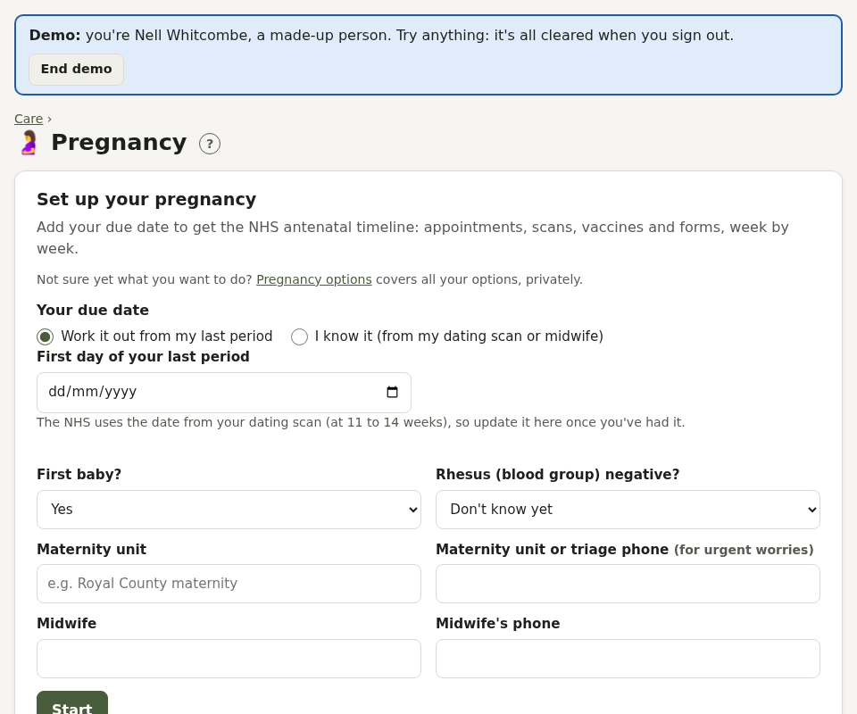

# Pregnancy

Switch on **Pregnancy** in your health profile. It's offered if your body inventory includes a uterus (or isn't filled in). Pillbox sits alongside your maternity notes, not instead of them, and never interprets results.

## Setting up

Enter your due date, worked out from the first day of your last period or as given at your dating scan (the NHS uses the scan date, so update it afterwards). Add whether it's a first baby, whether you're Rhesus negative, and your maternity unit and midwife's phone numbers.

## The page

- **How far along**: weeks and days, trimester, due date and days to go
- **Something not right?**: when to call the maternity unit straight away, with call buttons. **Baby's movements feel different** logs it and tells you to call now: there's no number of kicks to count.
- **Antenatal timeline**: the usual NHS appointments, scans, vaccines (whooping cough, RSV, flu) and forms (MatEx, MATB1, maternity leave notice), with dates worked out from your due date. **Book** adds an appointment; **Done** records it, with space for results. Extra checks for first babies only appear if it's your first.
- **Check-ups**: blood pressure, urine, bump measurement, heartbeat, position, notes and questions for next time. Blood pressure also goes into Readings. A reading of 140/90 or more is flagged to mention to your midwife.
- **Supplements**: add folic acid (until 12 weeks) and vitamin D to Meds in one tap.
- **Notes and movements**

When your baby arrives, or if the pregnancy ends, **close the record**: everything is kept.

Pillbox also prompts you if you take medicines that need a review in pregnancy (some blood pressure, thyroid and diabetes medicines).
