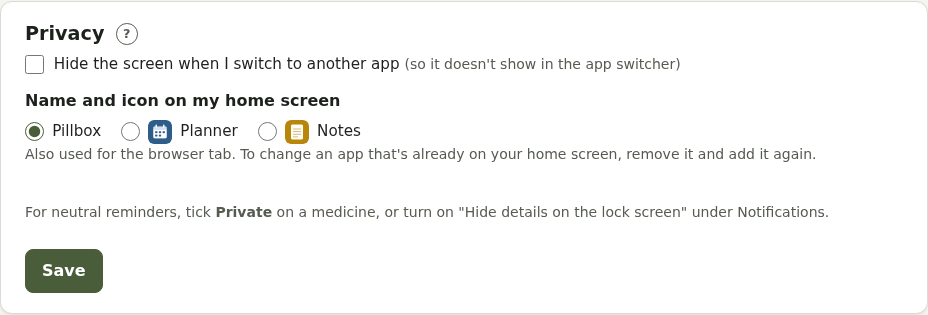

# Privacy and security

Pillbox runs on a server chosen by whoever set it up, not a big company's cloud. It has no adverts, tracking or analytics, and uses one cookie, to keep you signed in. See your Pillbox's **Privacy** page (in the footer) for the details of how it handles your information.

## Private medicines

Tick **Private** on a medicine: reminders and emails just say "Reminder", and it's hidden from anyone you share Pillbox with.

## Private pages

**Pregnancy options and aftercare** and **Gender-affirming care** are encrypted, can have their own PIN, are never shared, never appear on Today, in emails, reports or downloads, and can be deleted completely in one go. Their browser tab just says "Private". Mind can have a PIN too.

## Account → Privacy

- **Hide the screen when I switch to another app**: covers Pillbox in the app switcher
- **Name and icon on my home screen**: "Planner" or "Notes" instead of Pillbox. Remove it from your home screen and add it again for the new icon.

## Notifications

**Hide details on the lock screen** (Account → Notifications) makes every notification say "You have a reminder".

## Your data

Download everything, import it elsewhere, or delete your account at any time from **Account → Your data**. Deleting removes it from Pillbox straight away; copies in the server's own backups are outside Pillbox's control.

## Keeping your account safe

Use a strong password (or single sign-on), and **sign out everywhere else** if you've signed in on a device you no longer use.
