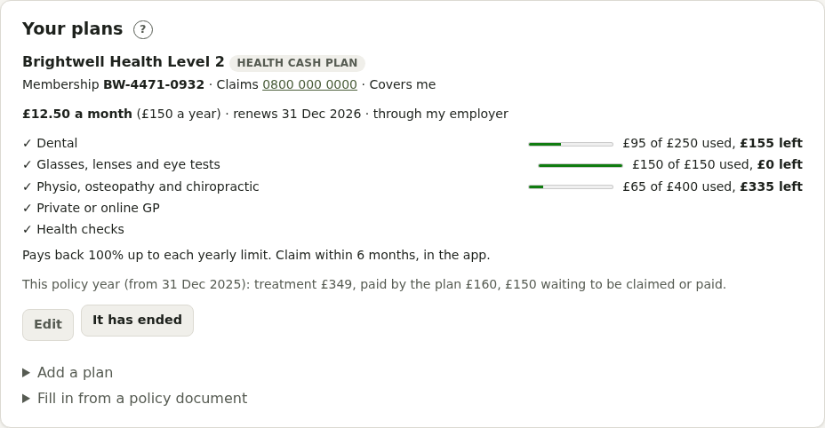
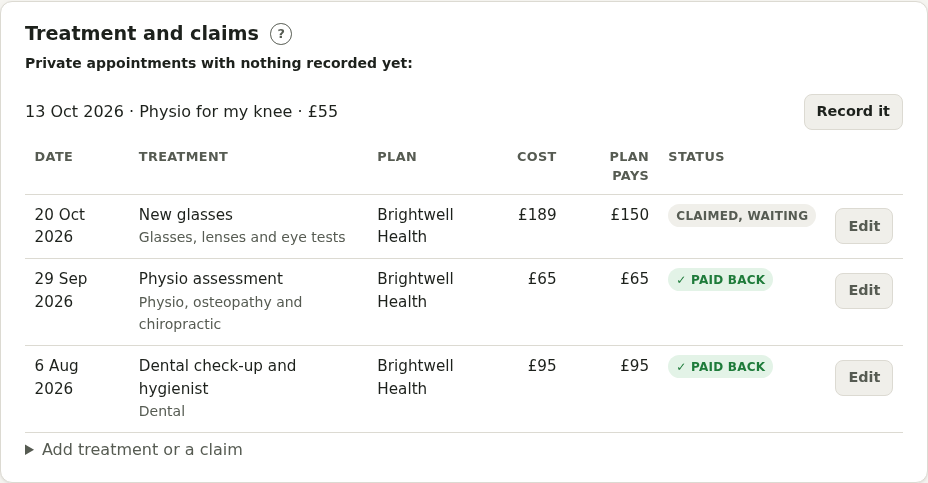
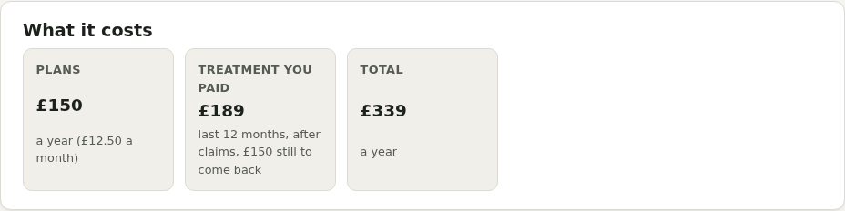

# Private health care

Switch on **Private health care** in your health profile, or add a plan during the first-time setup. It's for private medical insurance, health cash plans, dental plans, and care you pay for yourself.

## Your plans

**Add a plan** with:

- the type (insurance, cash plan, dental plan, self-pay), who it's with, the plan name, and your **membership number**
- the **claims and pre-authorisation phone number** (tap to call) and website or app
- what it **costs** a month or a year, the **excess**, and the **renewal date**
- who's covered, and whether it's through your employer
- **what it covers**: in-patient and out-patient care, tests and scans, physio, mental health, cancer care, private GP, dental, optical, hearing and more. Add a **yearly limit** to any of them (for example a cash plan's £250 for dental) to see how much is used and how much is left.
- for insurance: the underwriting, the six-week option, the hospital list, and exclusions

### Filling in from a policy document

**Fill in from a policy document** (on the Private health care page, or in the setup step) reads your policy schedule, membership certificate or plan summary, and fills in the plan form for you to check. Upload a PDF or Word document, or paste the text. It looks for the provider, plan type and name, membership number, cost, excess, renewal date (or a year after the start date), underwriting, six-week option, hospital list, claims phone, website, what's covered and any yearly limits, and tells you what it found.

- Nothing is saved until you've checked the form and pressed **Save**. Documents are worded in many ways, so always compare it with the document.
- The document is read on your Pillbox's own server and then thrown away: it isn't kept, or sent to anyone else.
- Scans and photos have no text to read. Copy the key details from them (or from an email) and paste them in instead.

The renewal date appears in your checks, on Today and in your calendar, so you can review the price and compare before it renews. When a plan ends, press **It has ended**: it's kept for your records.

## Private appointments

When adding an appointment, tick **Private** and choose the plan (or **Paying myself**), the pre-authorisation number and the cost. The Private health care page lists the ones coming up, and warns if one has no pre-authorisation number yet: most insurers need you to call before treatment.

## Treatment and claims

Record private treatment, what it cost, what the plan pays, and where the claim is up to: to claim, claimed, paid back, paid by the plan directly, not covered, or paid yourself. After a private appointment, open it to record the claim in one step. Anything waiting to be claimed is flagged: most plans only pay claims made within a time limit.

**What it costs** adds up your plans for the year and what you paid for treatment after claims, over the last 12 months. Private prescriptions from Meds are listed too.

## Good to know

The page also has short notes on pre-authorisation and referrals, existing conditions, cash plans, health insurance through work, and keeping your GP informed. In an emergency, go to A&E or call 999.
