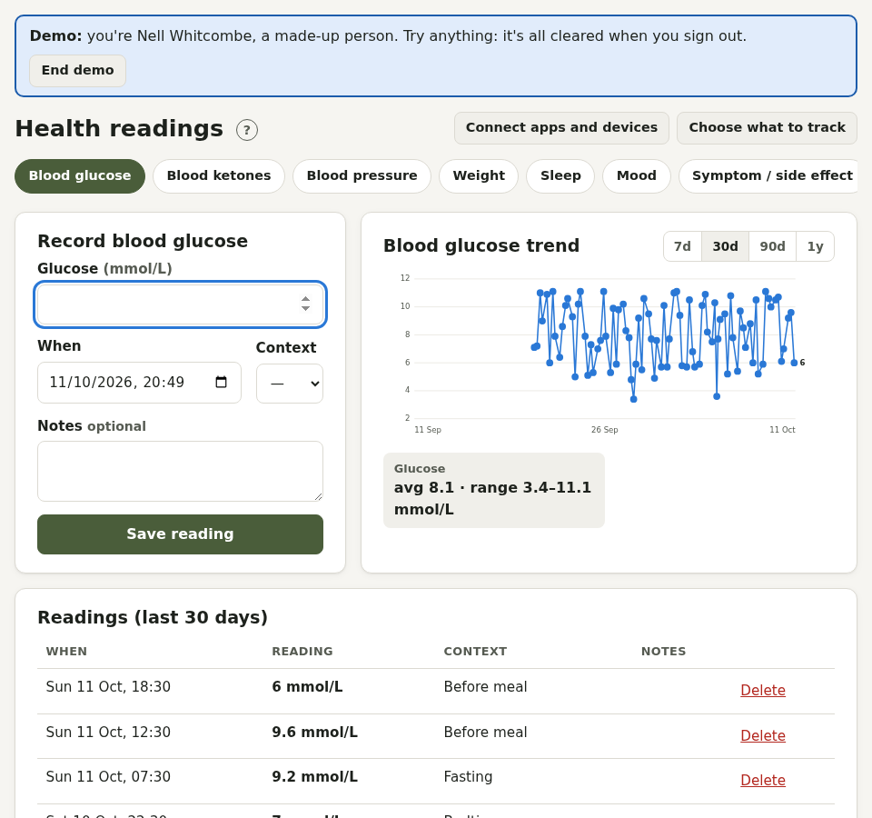

# Readings

The **Readings** tab holds measurements: blood pressure, heart rate, blood glucose, ketones, weight, temperature, oxygen level, breathing rate, peak flow, INR, cholesterol, pain, mood, sleep, fluids, steps, heart rate variability, calories and symptoms. Choose which ones you see in **Account → Health profile**, or add your own.

## Logging a reading

Pick the measurement, enter the value, when it was taken, and optionally the context (for example "Before meal" for glucose) and notes. Each measurement has a chart and averages.

Some readings bring up advice straight away:

- **Blood pressure** of 180/120 or more, or very low with dizziness
- **Glucose** under 4 opens the [hypo guide](diabetes.md#the-hypo-guide)
- **Ketones** show what the level means and what to do

## Connecting apps and devices

**Readings → Connect apps and devices** brings readings in automatically. Each imported reading is labelled with where it came from, and importing again never creates duplicates.

- **Apple Health**: upload the Health app's export, or sync every day from an iPhone app
- **Android Health Connect**: an Android app can send readings to your private sync link
- **WHOOP, Fitbit, Withings and Oura**: press **Connect** (if your administrator has set them up)
- **MyFitnessPal** and **Google Fit**: import their export files
- **Nightscout** (CGM glucose): connect in [Diabetes](diabetes.md#cgm-and-nightscout)
- **Blood pressure monitors**: import a CSV export in [Blood pressure](blood-pressure.md#importing-from-your-monitor)
