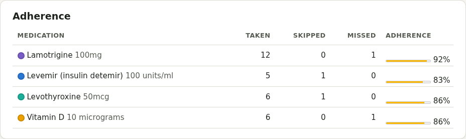
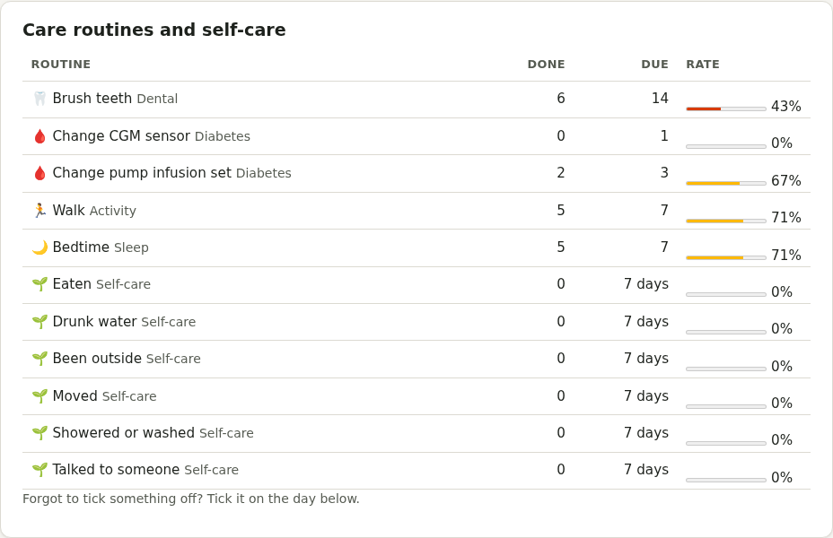

# History and reports

## History

The **History** tab shows each day's doses (taken, skipped, not logged) and the percentage of doses taken for each medicine.

It also shows your **Care routines**, Mind habits and **self-care** checklist for each day, with how often each was done over the period. Forgot to tick something off? Tick it on the right day in History, as far back as a year. **Show** picks medicines, Care, or both; choosing a single medicine shows just that medicine. If Mind has a PIN, self-care and Mind habits only appear once it's unlocked.

## Reports and summaries

Each prints as one page (or save it as a PDF from the print dialog):

- **Doctor's report** (the **Report** tab): allergies, current medicines with dm+d codes, dose changes, how well doses were taken, as-needed medicines used, appointments and readings, for the dates you choose (up to a year). **Doses CSV** and **Readings CSV** download the same period as a spreadsheet.
- **Care summary** (Care)
- **Mind summary** (Mind)
- **Menopause**, **premenstrual symptoms**, **thyroid**, **diabetes**, **blood pressure** and **migraine** summaries, from each Care page
- **Communication passport** and **assessment prep** (ADHD and autism)

Your pronouns, if you've added them, appear next to your name.

## Downloading your data

**Account → Your data → Download all my data** gives one file with everything (readable sections, plus a complete backup that another Pillbox can import). Private pages are left out.
