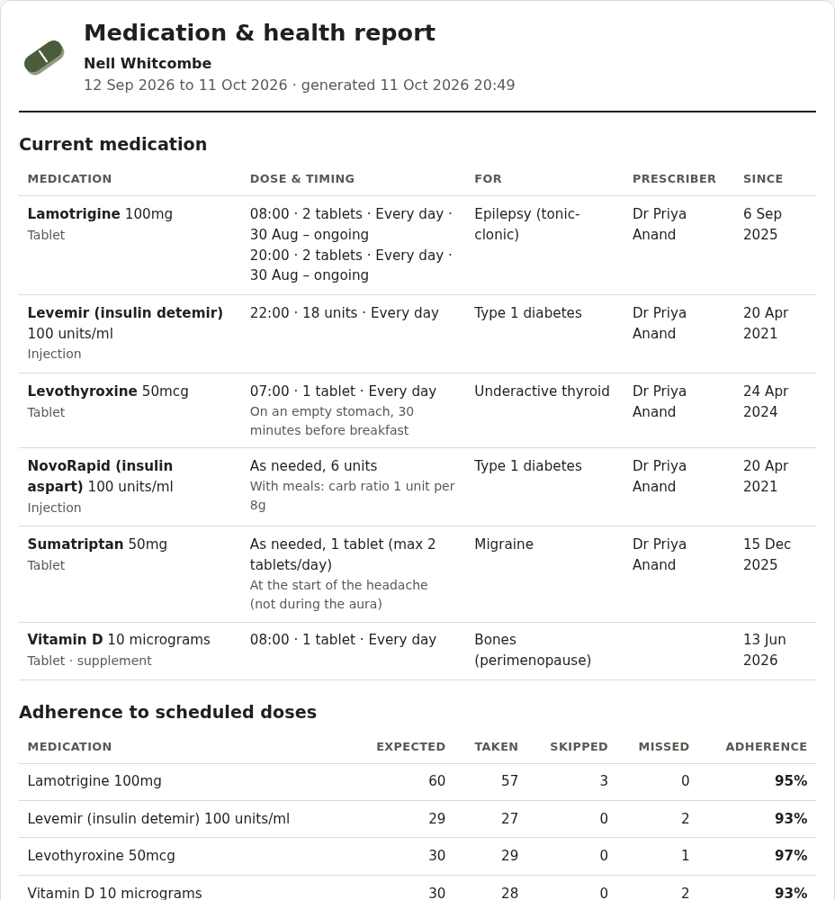

# History and reports

## History

The **History** tab shows each day's doses (taken, skipped, not logged) and the percentage of doses taken for each medicine.

## Reports and summaries

Each prints as one page (or save it as a PDF from the print dialog):

- **Doctor's report** (History): current medicines with dm+d codes, how well doses were taken, dose changes, readings and appointments
- **Care summary** (Care)
- **Mind summary** (Mind)
- **Menopause**, **premenstrual symptoms**, **thyroid**, **diabetes**, **blood pressure** and **migraine** summaries, from each Care page
- **Communication passport** and **assessment prep** (ADHD and autism)

Your pronouns, if you've added them, appear next to your name.

## Downloading your data

**Account → Your data → Download all my data** gives one file with everything (readable sections, plus a complete backup that another Pillbox can import). Private pages are left out.
