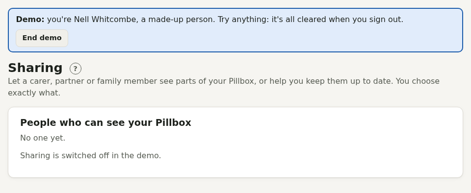

# Sharing with a carer or partner

Under **Sharing** (the people icon), give someone with an account on the same Pillbox access to parts of yours.

For each part (medicines and doses, readings, appointments, Care, Mind, reports) choose **no access**, **see**, or a level of change: for medicines, **log doses** (take, skip, collected prescriptions) or **change medicines**. You can also keep chosen Care categories private, include or leave out the Mind journal, and set an end date. Quick choices: "See everything except Mind", "Help with medicines", "Full help".

They open your Pillbox from their own Sharing page, with a banner showing whose it is and **Back to mine**. They never see your account settings, sign-in details, sync and calendar links, data download or Mind PIN, and can't share your Pillbox further.

Each part's permission applies wherever that information appears, not just on its own page. For example, someone without access to Readings won't see readings in Care, on the report or on Today, and can't add them from the hypo guide or a blood pressure check-up. Someone without access to Medicines won't see your medicines anywhere.

Some things are never shared, whatever you choose: **private medicines**, and the private pages **Pregnancy options and aftercare** and **Gender-affirming care**.

Every change they make is listed under **Recent activity**, and you can stop sharing at any time.
