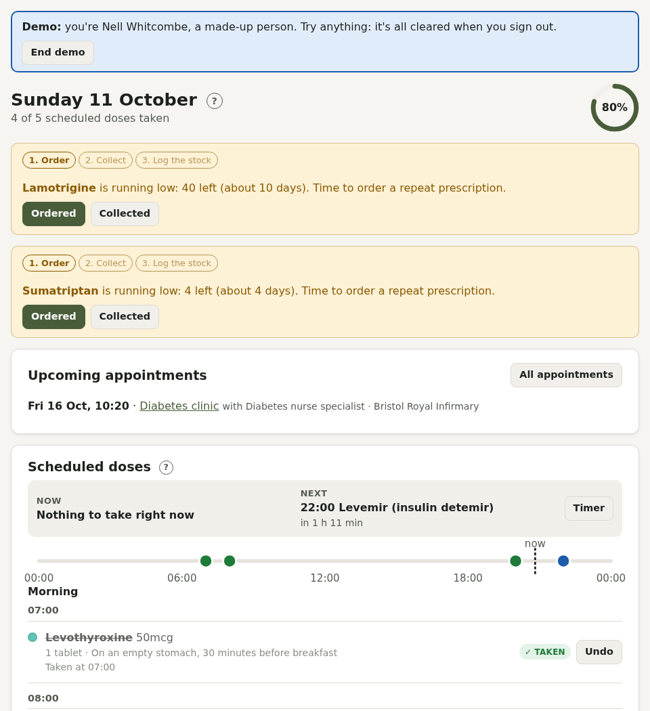
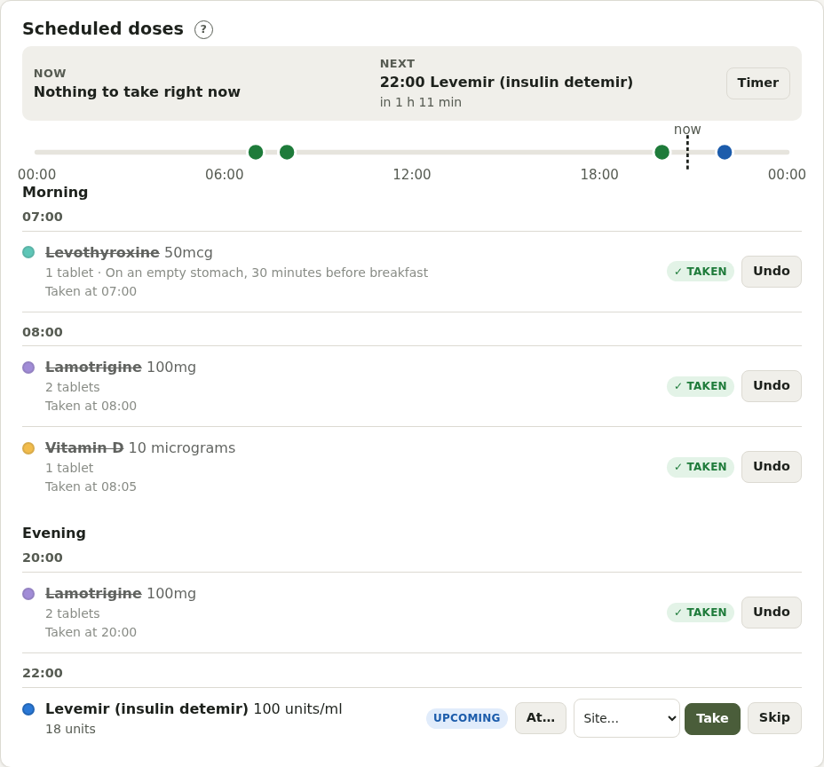
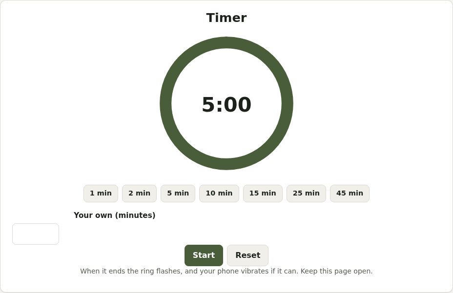

# Today

Today shows what to take, what's coming up, and anything that needs your attention.

## Now and next

At the top of your doses:

- **Now**: anything due or not yet logged
- **Next**: the next dose and how long until it
- A **timeline** of the day: each dose as a dot (green taken, grey skipped, amber not logged, coloured due, blue later), with a line for now
- **Timer**: a visual countdown, for anything from waiting for a medicine to work to a break

## Doses

Doses are grouped into **Morning** (before 12:00), **Afternoon** (12:00 to 17:00) and **Evening**.

- **Take** logs it now. **Skip** logs that you didn't take it (that's fine: it's just a record).
- **At…** logs it with the time you actually took it, if you're logging it later ("I took it at 9").
- **Take all morning** logs every dose in that part of the day in one go.
- **Undo** removes a log if you pressed the wrong thing.
- Injections ask which **site** you used, and suggest the next one in your rotation.

Doses that weren't logged show as **Not logged**. Yesterday's are listed separately so you can catch up: log them with the time you took them, or skip them.

**As needed** medicines (like painkillers) have their own section: enter the amount and press **Log dose**. If you reach the daily maximum, Pillbox checks before logging more.

## Notices

You may see notices for:

- **Running low**: a medicine is close to running out. Press **Ordered** when you've asked for more; the notice then shows **Collected**, where you enter how many you picked up. The steps (order, collect, log stock) are shown along the top. For controlled drugs, it shows the date to collect a prescription by.
- **Expiring** medicines
- **Coming up**: checks, screening, renewals and cycle notes due soon
- **Appointments** in the next two weeks
- **Sick-day rules** (Diabetes), an **ongoing headache** (Migraine), or sign-ups waiting (admins)

## Care routines

Routines from your Care categories (brushing teeth, physio exercises, foot checks…) appear with tick boxes. Tick them as you go.
